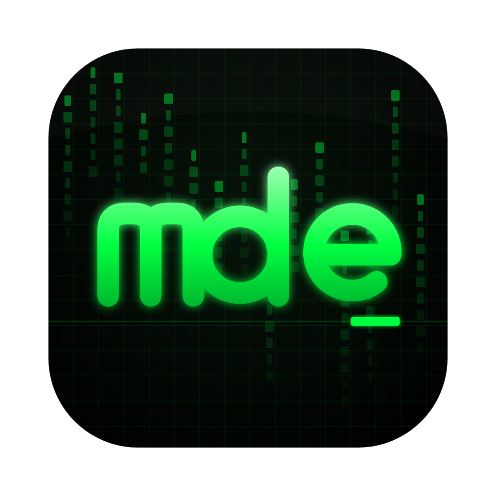
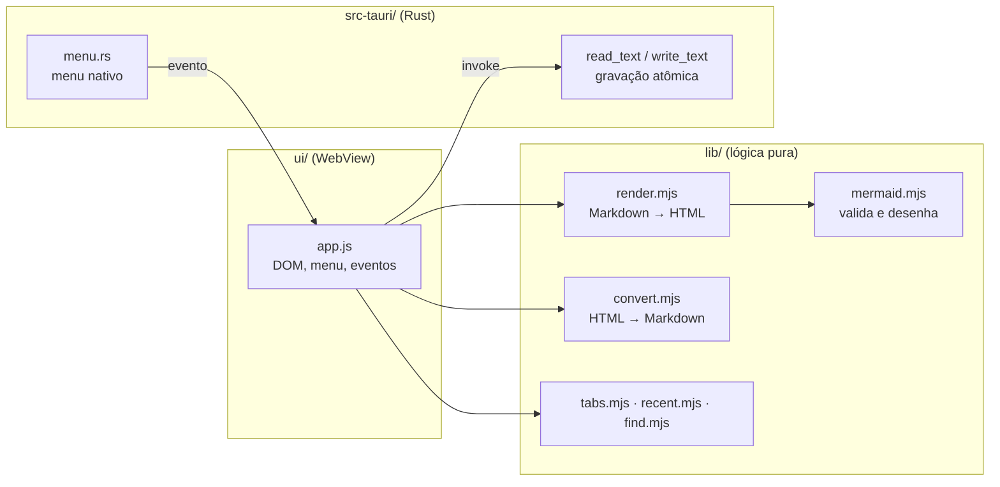

<p align="center"></p>

# kMdedit

Editor de Markdown para desktop (macOS, Windows e Linux), construído com
[Tauri 2](https://tauri.app). Um único painel alterna entre **WYSIWYG**,
**Código** e **Visualizar**, no estilo Typora, com diagramas
[Mermaid](https://mermaid.js.org) desenhados no lugar.

Projeto open source de [Marcos Khoriati](https://khori.com.br), licença MIT.

## Sumário

- [Recursos](#recursos)
- [Instalação](#instalação)
- [Uso](#uso)
- [Atalhos](#atalhos)
- [Desenvolvimento](#desenvolvimento)
- [Arquitetura](#arquitetura)
- [Licença](#licença)

## Recursos

- **Três modos por aba.** WYSIWYG com digitação estilo Typora (`# `, `- `,
  `- [ ] `, `> `, ` ``` `, `**negrito**`, `` `código` ``), Código (texto puro)
  e Visualizar (somente leitura).
- **Diagramas Mermaid** em blocos ```` ```mermaid ````. O botão de diagrama
  oferece modelos prontos: fluxograma, sequência, classes, estados, ER, Gantt,
  linha do tempo, jornada, pizza, XY, quadrantes, Sankey, mapa mental, git, C4,
  requisitos e blocos. No WYSIWYG, clicar no diagrama abre o código; ao sair do
  bloco ele é desenhado de novo.
- **Falha segura.** Um diagrama inválido vira um cartão de erro com a fonte; o
  restante do documento continua normal e nada vaza para fora do editor.
- **Busca** (Cmd/Ctrl+F) nos três modos, com contagem e navegação.
- **Abas, arquivos recentes** (até 20), zoom e temas claro, escuro e alto
  contraste.
- **Arrastar e soltar.** Qualquer arquivo de texto solto sobre a janela abre em
  uma aba: Markdown em WYSIWYG, outros formatos em Código. Binários são recusados
  com aviso.
- **Gravação atômica** (arquivo temporário + rename), normalização de quebras de
  linha e confirmação ao fechar aba ou janela com alterações pendentes.
- **Segurança.** HTML renderizado passa pelo DOMPurify e a janela roda sob CSP
  restritiva.

## Instalação

Não há binários publicados ainda. Para gerar o instalador da sua plataforma:

```bash
git clone https://github.com/khoriati/kMdedit.git
cd kMdedit
npm install
npm run build   # instaladores em src-tauri/target/release/bundle
```

Pré-requisitos: Node 20+, Rust estável e as dependências do Tauri para o seu
sistema (veja <https://tauri.app/start/prerequisites/>). No macOS basta o
Xcode Command Line Tools; no Linux são necessários WebKitGTK e libs de build;
no Windows, o Visual Studio Build Tools e o WebView2.

## Uso

1. Abra um arquivo (Cmd/Ctrl+O), arraste-o para a janela ou crie uma aba nova.
2. Escreva no modo WYSIWYG; os marcadores Markdown viram formatação ao digitar.
3. Alterne para Código quando quiser ver ou editar a fonte, e para Visualizar
   para ler o resultado final.
4. Para inserir um diagrama, use o botão de diagrama (Cmd/Ctrl+Alt+M) e escolha
   um modelo. Dentro de um bloco de código, Enter quebra linha; Cmd/Ctrl+Enter
   ou Enter após uma linha vazia sai do bloco.
5. Salve com Cmd/Ctrl+S. O arquivo é gravado de forma atômica e com quebras de
   linha normalizadas.

Preferências (tema, zoom e recentes) ficam no armazenamento local da janela. Os
documentos são arquivos comuns no disco; o app não cria pastas próprias.

## Atalhos

| Ação | Atalho |
| --- | --- |
| Nova aba | Cmd/Ctrl+N ou Cmd/Ctrl+T |
| Abrir | Cmd/Ctrl+O |
| Salvar / Salvar como | Cmd/Ctrl+S / Cmd/Ctrl+Shift+S |
| Fechar aba | Cmd/Ctrl+W |
| Localizar / próxima ocorrência | Cmd/Ctrl+F / Enter (Shift+Enter volta) |
| Alternar modo (WYSIWYG → Código → Visualizar) | Cmd/Ctrl+Shift+R |
| Próxima / aba anterior | Ctrl+Tab / Ctrl+Shift+Tab |
| Zoom | Cmd/Ctrl+= , Cmd/Ctrl+- , Cmd/Ctrl+0 |
| Títulos 1 a 6 (WYSIWYG) | Cmd/Ctrl+1 … 6 |
| Negrito / itálico / código / link | Cmd/Ctrl+B / I / E / K |
| Lista / numerada / tarefas / citação | Cmd/Ctrl+Alt+U / O / X / Q |
| Bloco de código / Mermaid / linha horizontal | Cmd/Ctrl+Alt+C / M / − |
| Sair do bloco de código | Cmd/Ctrl+Enter |

## Desenvolvimento

```bash
npm install
npm run dev        # compila o bundle da UI e abre o app em modo dev
npm run build      # gera os instaladores em src-tauri/target/release/bundle
npm test           # testes da lógica JS (node:test + jsdom)
npm run test:rust  # testes do backend Rust
```

Toda a lógica testável fica em `lib/` como módulos ES puros; `ui/app.js` só
liga DOM, menu e eventos. Novos comportamentos devem entrar em `lib/` com um
teste em `test/`.

## Arquitetura

```
assets/     logotipo (SVG fonte e PNG 1024); os ícones do app vêm de `tauri icon`
lib/        lógica pura e testável (render, mermaid, conversão, abas, regras)
ui/         index.html, style.css e app.js (bundle gerado em ui/dist)
src-tauri/  backend Rust: leitura/escrita de texto, menu nativo, permissões
test/       suíte node:test
```



**Renderização com falha segura.** `lib/mermaid.mjs` valida cada diagrama com
`mermaid.parse` antes de desenhar, desenha em um container isolado fora da tela,
aplica timeout e limpa elementos temporários. `lib/render.mjs` troca uma falha
do parser por um bloco de aviso com a fonte. Em `ui/app.js`, cada renderização
tem um número de geração (trocar de aba abandona a anterior) e erros não
tratados vão para a barra de status em vez de derrubar a interface.

## Licença

MIT. Veja [LICENSE](LICENSE).
